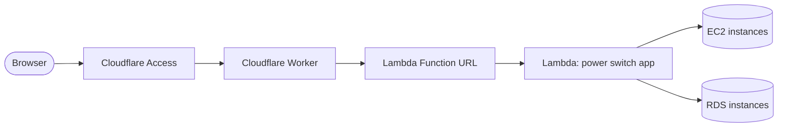
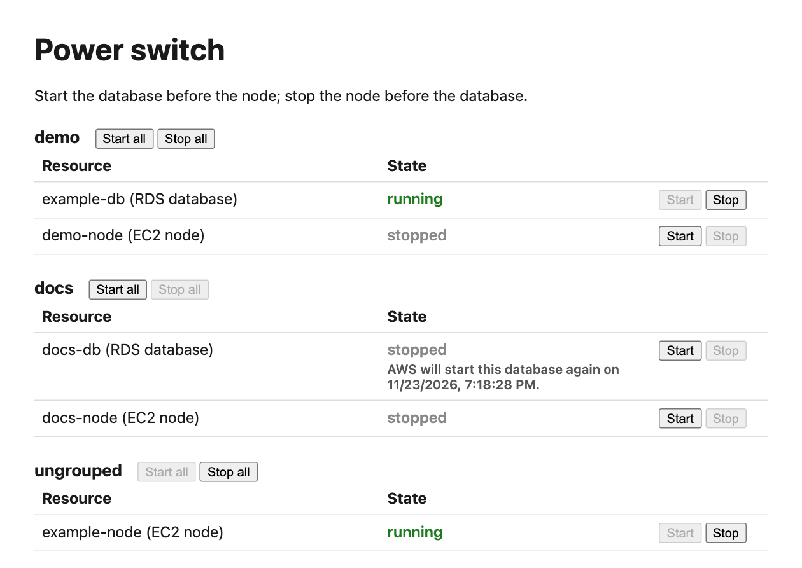
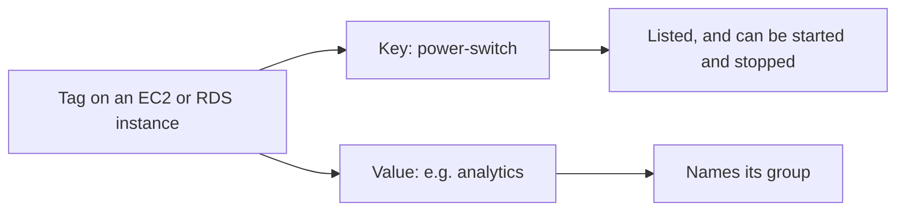
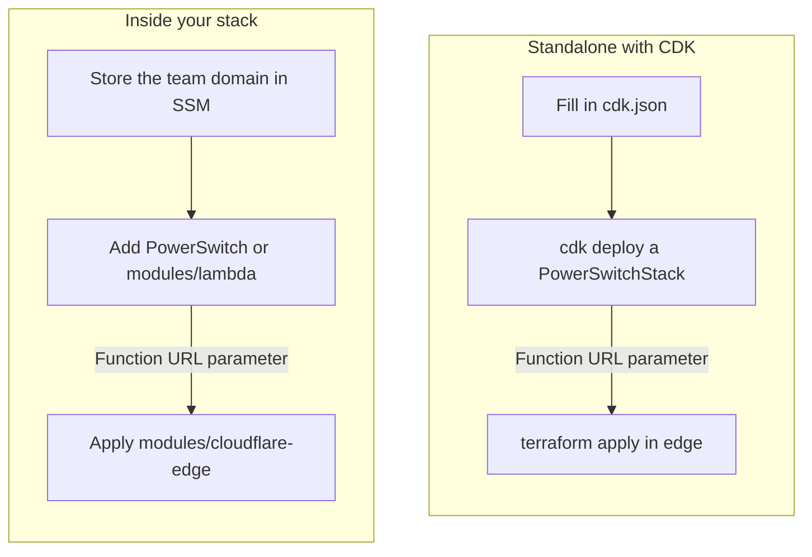
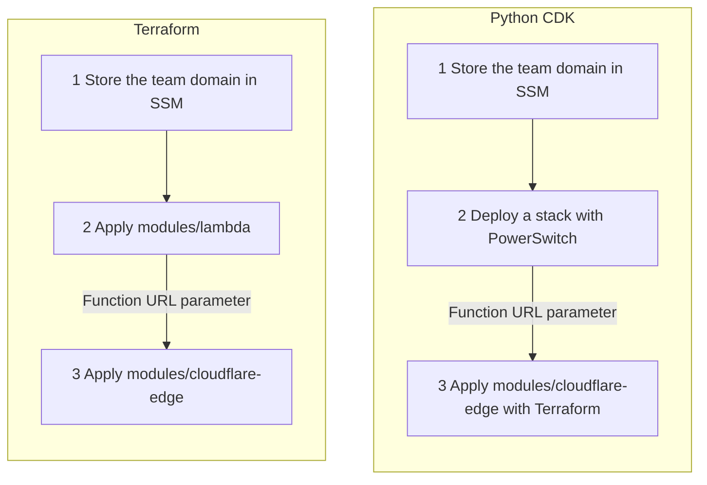
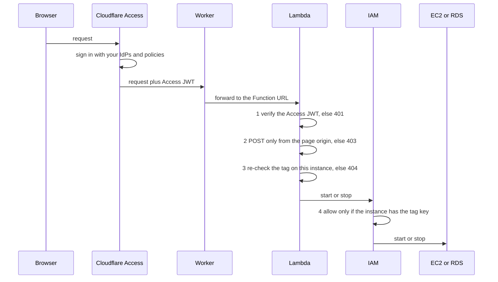
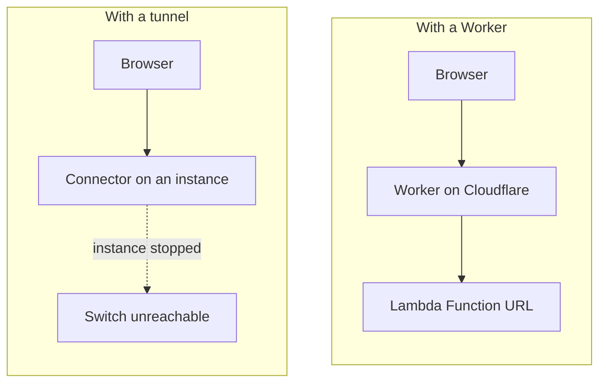

# aws-power-switch

**A small web page, behind Cloudflare Access, that starts and stops the tagged EC2 and RDS instances in one AWS account.** Turn compute on while someone works, off when they're done.



**What you get**

- One page per AWS account that lists every EC2 and RDS instance carrying your tag key, with its state and Start / Stop buttons, grouped by tag value, with Start all / Stop all per group.
- Sign-in through your existing Cloudflare Access identity providers and policies.
- The same app and the same AWS resources whichever way you install it: a Terraform module or a Python CDK construct. A second Terraform module puts the Cloudflare side in front of it.
- Defence in depth: the Access token is checked on every request, the tag is checked again on every action, and IAM only lets the function start and stop tagged instances.
- No servers to run and no npm dependencies: one Node 22 Lambda using the AWS SDK that ships with the runtime. MIT licensed (see [`LICENSE`](LICENSE)).

<p align="center"></p>

**Contents:** [Tag contract](#the-tag-contract) · [Standalone or inside your stack](#standalone-or-inside-your-stack) · [Install](#install) · [Security model](#security-model) · [Why a Worker, not a tunnel](#why-a-worker-and-not-a-tunnel) · [Local development](#local-development)

## The tag contract



| Part of the tag | What it does |
| --- | --- |
| **Key** (`tag_key`, default `power-switch`) | Marks the instance as switchable. Only instances carrying this key are listed, and only they can be started or stopped. The key alone decides access; IAM and the app both check it. |
| **Value** | Names the instance's group. The page shows one section per group, sorted by name, with an empty value listed last as "ungrouped"; the list API returns it as `group`. It is for display only and grants nothing. |

- Only **EC2 instances** and **RDS DB instances** are ever listed or actionable. Other resource types are ignored even when tagged.
- Untagging an instance takes it out of the switch's reach at once.
- Anyone the install's Access policies let in can switch every tagged instance in that account; there are no per-group permissions.

```sh
aws ec2 create-tags --resources i-0123456789abcdef0 --tags Key=power-switch,Value=analytics
aws rds add-tags-to-resource --resource-name arn:aws:rds:us-east-1:111122223333:db:example-db \
  --tags Key=power-switch,Value=analytics
```

## Standalone or inside your stack

Deploy the power switch as its own stack from a ready-made example in this repo, or add it to a stack you already have. Either way you get the same Lambda, Worker and Access application.



| | Terraform | CDK (Python) |
| --- | --- | --- |
| **Standalone**, as its own stack | Coming soon. Until then, use the modules as in [Install](#install). | [`examples/cdk-standalone`](examples/cdk-standalone): `cdk deploy` a `PowerSwitchStack` built from `cdk.json`, then `terraform apply` in its [`edge/`](examples/cdk-standalone/edge) folder. The edge apply also stores your Access team domain and creates the Access policy from `allowed_emails`. |
| **Inside your stack** | `modules/lambda`, then `modules/cloudflare-edge`: [Install](#install), steps 1, 2a and 3. | The `PowerSwitch` construct in your stack, then `modules/cloudflare-edge`: [Install](#install), steps 1, 2b and 3. |

The examples use the modules and the package from your clone of this repo, so they deploy the code you have checked out. The snippets under [Install](#install) pin the `v0.1.0` release instead.

### CDK standalone

Needs Python 3.10 or later, Node 22, the [AWS CDK CLI](https://docs.aws.amazon.com/cdk/v2/guide/cli.html), Terraform, an AWS account [bootstrapped for CDK](https://docs.aws.amazon.com/cdk/v2/guide/bootstrapping.html), and an existing Access identity provider in Cloudflare Zero Trust.

```sh
git clone https://github.com/freshmick/aws-power-switch.git
cd aws-power-switch/examples/cdk-standalone
pip install -r requirements.txt   # the CDK package from this clone

# 1. AWS side: set your values in cdk.json, then
cdk deploy

# 2. Cloudflare side, in the same AWS account and region (AWS_REGION) as the stack
cd edge
cp terraform.tfvars.example terraform.tfvars   # fill it in; it says where to find each ID
export CLOUDFLARE_API_TOKEN=...
terraform init
terraform apply
```

| `edge/` input | What it is |
| --- | --- |
| `account_id`, `zone_name`, `power_hostname`, `name_prefix` | Your Cloudflare account and the hostname of the page. `power_hostname` must match `cdk.json`. |
| `access_team_domain_parameter`, `access_aud_parameter`, `function_url_parameter` | The SSM parameter names from `cdk.json`. The edge writes the team domain and the audience, and reads the Function URL. |
| `identity_provider_ids` | IDs of existing Access identity providers to sign in with. |
| `allowed_emails` | Who may sign in. Must not be empty. |

The edge root has no backend block, so its state stays in a local `terraform.tfstate`. For real use, configure a remote [S3 backend](https://developer.hashicorp.com/terraform/language/backend/s3).

## Install

Each install is one Lambda in one AWS account plus one hostname in Cloudflare. Pick Terraform or CDK for the AWS side; the Cloudflare side is always the Terraform `cloudflare-edge` module.



The pieces talk through three SSM parameters in the Lambda's account and region. Their names are inputs, so you choose them:

| Parameter | Written by | Read by |
| --- | --- | --- |
| `access_team_domain_parameter` | **you**, once (step 1) | the Lambda, at cold start |
| `function_url_parameter` | the lambda module or the CDK construct | the edge module, at plan time, unless you pass it `function_url` instead |
| `access_aud_parameter` | the edge module | the Lambda, at cold start |

**Apply order:** the AWS side first (lambda module or CDK stack), then the edge module. Given `function_url_parameter`, the edge module reads the Function URL from the SSM parameter the AWS side writes, so it can't plan before that parameter exists. Given `function_url` instead, it reads no parameter. Until the edge has written the Access AUD parameter, the Lambda can't load its settings and every request fails; it tries again on the next request.

### 1. Store your Access team domain

Your Cloudflare Zero Trust team domain, without `https://`:

```sh
aws ssm put-parameter --name /example/access_team_domain --type String \
  --value example.cloudflareaccess.com
```

### 2a. AWS side with Terraform

```hcl
module "power_switch" {
  source = "git::https://github.com/freshmick/aws-power-switch.git//modules/lambda?ref=v0.1.0"

  name_prefix                  = "example"
  power_hostname               = "power.example.com"
  access_team_domain_parameter = "/example/access_team_domain"
  access_aud_parameter         = "/example/power/access_aud"
  function_url_parameter       = "/example/power/function_url"
}
```

If the edge module lives in the same root module, pass it `function_url = module.power_switch.function_url` instead of `function_url_parameter` and a single `terraform apply` does both. With `function_url_parameter`, apply this one first with `terraform apply -target=module.power_switch`, then run `terraform apply`.

### 2b. AWS side with CDK (Python)

```sh
pip install "aws-power-switch-cdk @ git+https://github.com/freshmick/aws-power-switch.git@v0.1.0#subdirectory=cdk"
```

```python
from aws_power_switch_cdk import PowerSwitch

PowerSwitch(
    stack,
    "PowerSwitch",
    name_prefix="example",
    power_hostname="power.example.com",
    access_team_domain_parameter="/example/access_team_domain",
    access_aud_parameter="/example/power/access_aud",
    function_url_parameter="/example/power/function_url",
)
```

The construct takes the same inputs, with the same defaults, as the Terraform lambda module, as keyword arguments. It exposes `function` (the Lambda function) and `function_url`. Deploy the stack, then apply the edge module below with Terraform, passing it the same `function_url_parameter` and `access_aud_parameter` names.

To deploy it as its own stack instead, use `PowerSwitchStack(app, "PowerSwitch", ...)`: the same keyword arguments, plus any `Stack` option such as `env` or `description`. It exposes the construct as `power_switch` and outputs the Function URL. [`examples/cdk-standalone`](examples/cdk-standalone) is a ready-made app around it, see [CDK standalone](#cdk-standalone).

### 3. Cloudflare side (Terraform, for both)

```hcl
module "power_switch_edge" {
  source = "git::https://github.com/freshmick/aws-power-switch.git//modules/cloudflare-edge?ref=v0.1.0"

  account_id             = "0123456789abcdef0123456789abcdef"
  name_prefix            = "example"
  zone_name              = "example.com"
  power_hostname         = "power.example.com"
  function_url_parameter = "/example/power/function_url"
  access_aud_parameter   = "/example/power/access_aud"
  allowed_idps           = ["00000000-0000-0000-0000-000000000000"]
  policy_ids             = ["11111111-1111-1111-1111-111111111111"]
}
```

The edge module needs both the `cloudflare` provider (`~> 5.0`) and the `aws` provider (`~> 6.0`); point the `aws` provider at the Lambda's account and region, since that's where the parameters live. It creates a Worker on `power_hostname` (with its DNS record) and an Access application that allows exactly your `allowed_idps` and `policy_ids`. It creates no Access policy of its own.

Then tag some instances ([tag contract](#the-tag-contract)) and open `https://power.example.com`.

### Inputs

**`modules/lambda` and the `PowerSwitch` construct** (same names and defaults)

| Input | Required | Default | What it is |
| --- | --- | --- | --- |
| `name_prefix` | yes | | Prefix for resource names; the function, role and log group are named `<name_prefix>-power-switch`. |
| `power_hostname` | yes | | Hostname the page is served on, e.g. `power.example.com`. POSTs from any other origin are refused. |
| `access_team_domain_parameter` | yes | | Name of the SSM parameter holding your Access team domain (you create it). Read only. |
| `access_aud_parameter` | yes | | Name of the SSM parameter holding the Access application's audience (the edge module writes it). Read only. |
| `function_url_parameter` | yes | | Name of the SSM parameter this module creates with the Function URL. |
| `tag_key` | no | `"power-switch"` | Only EC2 and RDS instances carrying this tag key are listed and switchable. |
| `reserved_concurrency` | no | `2` | Maximum concurrent invocations; caps what a flood on the public Function URL can use. |
| `log_retention_days` | no | `14` | How long the function's logs are kept, in days. |

**`modules/cloudflare-edge`** (all required, except that you set exactly one of `function_url` and `function_url_parameter`)

| Input | What it is |
| --- | --- |
| `account_id` | Cloudflare account ID that owns the Worker and the Access application. |
| `name_prefix` | Prefix for the Worker script and Access application names; lowercase letters, digits and hyphens. Unique per Cloudflare account. |
| `zone_name` | Cloudflare zone the hostname belongs to, e.g. `example.com`. |
| `power_hostname` | Hostname of the page, e.g. `power.example.com`; the same value as on the AWS side. |
| `function_url` | The Function URL itself, e.g. the lambda module's `function_url` output. The module then reads no SSM parameter. |
| `function_url_parameter` | Name of the SSM parameter holding the Function URL; the same name as on the AWS side. |
| `allowed_idps` | IDs of existing Access identity providers to sign in with. Must not be empty. |
| `policy_ids` | IDs of existing reusable Access policies, in precedence order. Must not be empty. |
| `access_aud_parameter` | Name of the SSM parameter to write the Access application's audience to; the same name as on the AWS side. |

<details>
<summary><b>Outputs</b></summary>

| Where | Output | What it is |
| --- | --- | --- |
| `modules/lambda` | `function_url` | The Function URL the edge forwards to. Returns 401 without a valid Access token. |
| `modules/lambda` | `function_name` | Name of the Lambda function. |
| `PowerSwitch` | `function` | The Lambda function construct. |
| `PowerSwitch` | `function_url` | The Function URL. |
| `modules/cloudflare-edge` | `access_aud` | Audience tag of the power switch's Access application. |

</details>

<details>
<summary><b>What gets created</b></summary>

**AWS** (lambda module or CDK construct, the same resources either way):

- Lambda function `<name_prefix>-power-switch`: Node 22, arm64, 128 MB, 15 s timeout, outside any VPC, with reserved concurrency.
- A public Function URL (auth type `NONE`; the app checks the Access token itself) and the permissions to invoke it.
- IAM role and inline policy, see [Security model](#security-model).
- CloudWatch log group `/aws/lambda/<name_prefix>-power-switch`.
- SSM parameter `function_url_parameter`.

**Cloudflare and AWS** (edge module):

- Worker script `<name_prefix>-power-switch` and a custom domain on `power_hostname`, which also creates its DNS record.
- Access application `<name_prefix> power switch` on `power_hostname`, using your identity providers and policies.
- SSM parameter `access_aud_parameter`.

</details>

## Security model

The Function URL is public, so the app trusts nothing in front of it. Every check below lives in the app or in IAM, and they stack:



| Check | Where | What it stops |
| --- | --- | --- |
| **Access JWT on every route** | [`app/access.mjs`](app/access.mjs), [`app/handler.mjs`](app/handler.mjs) | Every route, the page included, needs a valid `Cf-Access-Jwt-Assertion`: RS256, signed by your team's Access keys, with your application's `aud`, your team's `iss`, unexpired, and carrying `sub` and `email`. Otherwise 401. Calling the raw Function URL gets you nothing. |
| **Per-action tag re-check** | [`app/resources.mjs`](app/resources.mjs) | Before every start or stop, the app lists the tagged instances again and refuses (404) an ID that isn't among them. Only `ec2` and `rds` are valid types. |
| **Tag-conditioned IAM** | [`modules/lambda/iam.tf`](modules/lambda/iam.tf), [`cdk/src/aws_power_switch_cdk/iam.py`](cdk/src/aws_power_switch_cdk/iam.py) | The role can describe EC2 and RDS instances, but start and stop only instances carrying the tag key (`aws:ResourceTag/<tag_key>`, `rds:db-tag/<tag_key>`). It reads only the two Access parameters and writes only its own logs. |
| **Same-origin POSTs** | [`app/origin.mjs`](app/origin.mjs) | A start or stop POST must say `Sec-Fetch-Site: same-origin` or carry `Origin: https://<power_hostname>`. A form on another site, even another subdomain of your zone, gets 403. |
| **Junk-token guard** | [`app/access.mjs`](app/access.mjs) | Signing keys are cached; a token with an unknown key ID triggers at most one key fetch per minute, so random junk tokens can't make the function hammer Cloudflare. |
| **Reserved concurrency** | `reserved_concurrency` (default 2) | A flood on the public URL can't use up the account's shared Lambda concurrency. |

<details>
<summary><b>Also in place</b></summary>

- Every start and stop is logged as JSON audit lines (`requested`, then `accepted`, `refused` or `failed`) with the caller's `email` and `sub` from the verified token, never the token itself.
- AWS errors are logged, not returned; the browser sees `502 Upstream error`.
- Every response carries `Content-Security-Policy: frame-ancestors 'none'` and `X-Frame-Options: DENY`.
- The Worker copies only the path and query onto the Function URL, so a crafted path can't send the Access token to another host.
- The Access session cookie is `HttpOnly` and `SameSite=Lax`.

</details>

## Why a Worker and not a tunnel

A Cloudflare Tunnel needs a connector (`cloudflared`) running on some machine. If that machine is one of the instances the switch turns off, stopping it cuts off the switch itself, and there's no page left to start it again. The Worker runs on Cloudflare and forwards straight to the Lambda's Function URL, so the switch keeps working whatever state your instances are in.



## Local development

```sh
node app/dev/serve.mjs   # then open http://localhost:8787
```

The dev server runs the real handler and page against in-memory EC2 and RDS fakes, with no AWS and no Access check. It listens on `127.0.0.1` only. The screenshot above comes from it.

<details>
<summary><b>Dev server options</b></summary>

| Variable | Default | What it does |
| --- | --- | --- |
| `PORT` | `8787` | Port to serve on. |
| `POWER_SWITCH_DEV_HOST` | `127.0.0.1` | Address to listen on. Nothing checks who calls the dev server, so keep it local. |
| `POWER_SWITCH_DEV_FAIL` | unset | An instance ID, e.g. `docs-db`, whose start and stop fail, to see how the page reports a failed action. |

</details>

<details>
<summary><b>Running the tests (the same commands CI runs)</b></summary>

Needs Node 22, Terraform 1.17 and Python 3.10 or later (CI uses 3.12).

```sh
# App
node --test 'app/tests/*.test.mjs'

# Terraform lambda module
(cd modules/lambda && terraform fmt -check -diff && terraform init -backend=false && terraform validate)

# Terraform cloudflare-edge module and its Worker
node --test modules/cloudflare-edge/worker.test.mjs
(cd modules/cloudflare-edge && terraform init -backend=false -input=false && terraform validate && terraform test)

# CDK construct (aws-cdk-lib runs on Node, so Node must be on the PATH)
pip install "./cdk[test]"
(cd cdk && pytest)

# CDK standalone example: synth, then its edge root
pip install ./cdk
(cd examples/cdk-standalone && python app.py)
(cd examples/cdk-standalone/edge && terraform fmt -check -diff -recursive && terraform init -backend=false -input=false && terraform validate && terraform test)
```

</details>

<details>
<summary><b>Repo layout</b></summary>

| Path | What's there |
| --- | --- |
| `app/` | The Lambda app: handler, Access verifier, origin check, EC2 and RDS adapters, and the page. Tests in `app/tests/`, dev server in `app/dev/`. |
| `modules/lambda/` | Terraform module for the AWS side. |
| `modules/cloudflare-edge/` | Terraform module for the Cloudflare side, and the Worker. |
| `cdk/` | Python CDK construct `PowerSwitch`; ships `app/` as package data. |
| `examples/` | Ready-to-run examples that deploy the switch as its own stack, starting with `cdk-standalone/`. |
| `docs/adr/` | Design decisions, starting with [0001 Package design](docs/adr/0001-package-design.md). |

</details>
