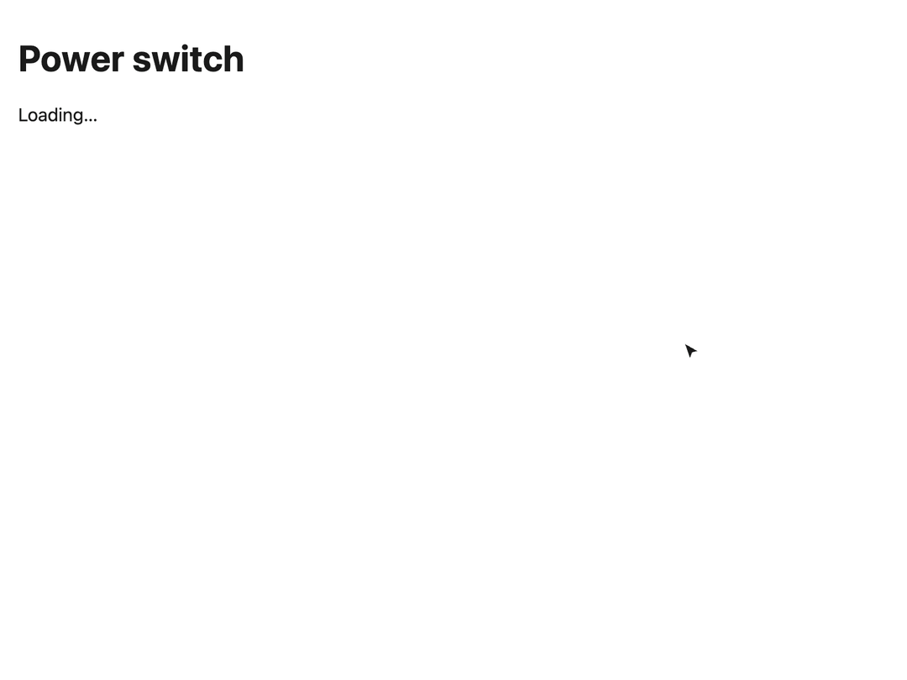
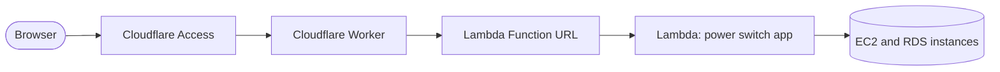
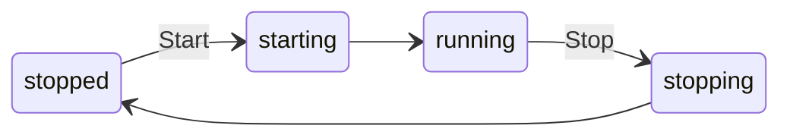
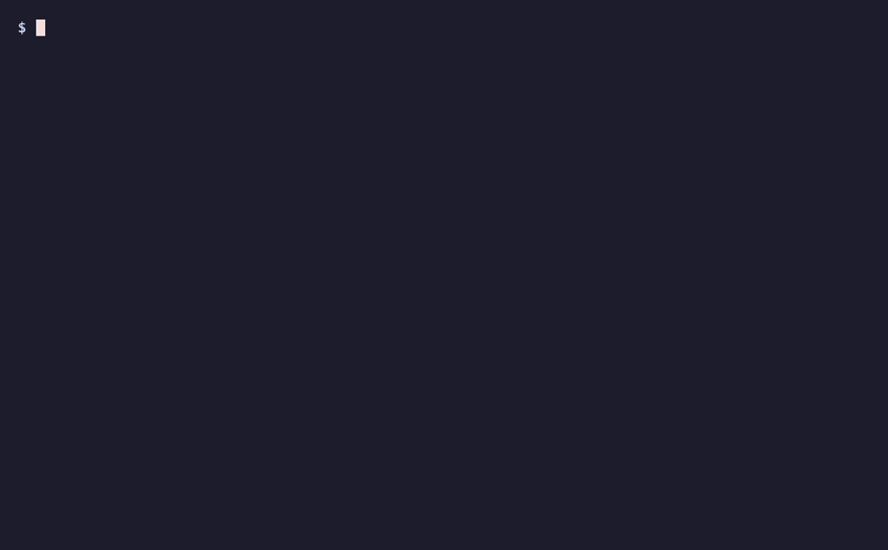
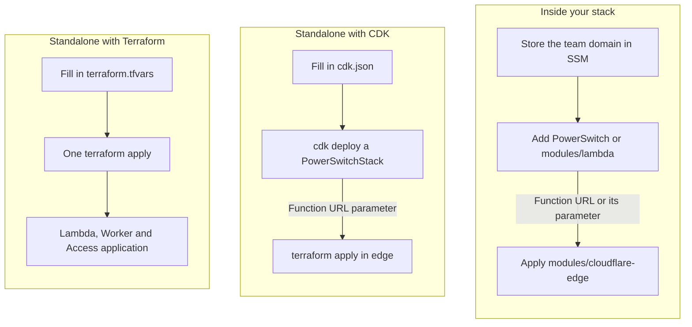
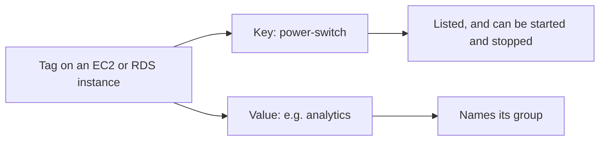
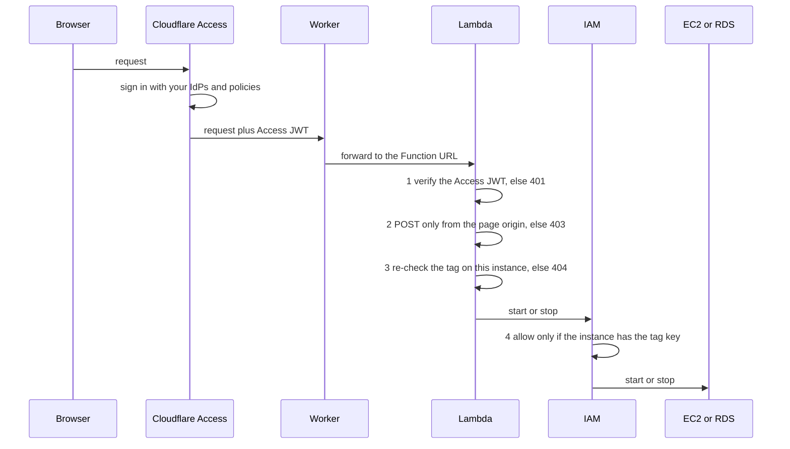
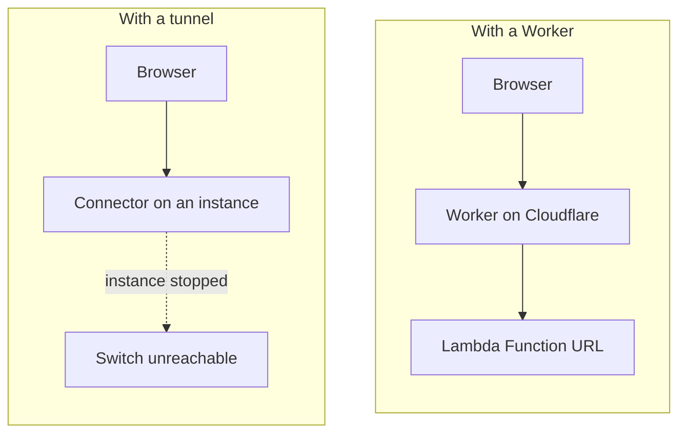

# aws-power-switch

**A small web page, behind Cloudflare Access, that starts and stops the tagged EC2 and RDS instances in one AWS account and region.**

[](https://github.com/freshmick/aws-power-switch/actions/workflows/ci.yml)
[](https://github.com/freshmick/aws-power-switch/releases/latest)
[](LICENSE)

<p align="center"></p>



**Contents:** [What you get](#what-you-get) · [Instance states](#instance-states) · [Install](#install) · [Tag contract](#the-tag-contract) · [Security model](#security-model) · [Why a Worker, not a tunnel](#why-a-worker-and-not-a-tunnel) · [Local development](#local-development)

## What you get

Turn compute on while someone works, off when they're done.

- One page per AWS account and region that lists every EC2 and RDS instance carrying your tag key, with its state and Start / Stop buttons, grouped by tag value, with Start all / Stop all per group.
- Sign-in through your existing Cloudflare Access identity providers and policies.
- The same app and the same AWS resources whichever way you install it: a Terraform module or a Python CDK construct. A second Terraform module puts the Cloudflare side in front of it.
- Defence in depth: the Access token is checked on every request, the tag is checked again on every action, and IAM only lets the function start and stop tagged instances.
- No servers to run and no npm dependencies: one Node 22 Lambda using the AWS SDK that ships with the runtime. MIT licensed (see [`LICENSE`](LICENSE)).

> [!NOTE]
> **One install covers one AWS account and one region.** It lists and switches only the instances in the region its Lambda runs in. For another region, install again there with a different `name_prefix` and hostname.

## Instance states

The page shows four states and drives an instance around this loop. Start is offered only when an instance is stopped, Stop only when it is running.



| The page shows | EC2 state | RDS status |
| --- | --- | --- |
| `stopped` | `stopped` | `stopped` |
| `starting` | `pending` | `starting` |
| `running` | `running` | `available` |
| `stopping` | `stopping`, `shutting-down` | `stopping` |

AWS starts a stopped RDS database again by itself 7 days after it was stopped. Next to a stopped database the page says when: "AWS will start this database again on" and the date.

## Install

Deploy the power switch as its own stack from a ready-made example in this repo, or add it to a stack you already have. Either way you get the same Lambda, Worker and Access application.

| | Terraform | CDK (Python) |
| --- | --- | --- |
| **Standalone**, as its own stack | [`examples/terraform-standalone`](examples/terraform-standalone): one `terraform apply` creates the Lambda, the Worker and the Access application, and also stores your Access team domain and creates the Access policy from `allowed_emails`. | [`examples/cdk-standalone`](examples/cdk-standalone): `cdk deploy` a `PowerSwitchStack` built from `cdk.json`, then `terraform apply` in its [`edge/`](examples/cdk-standalone/edge) folder. The edge apply also stores your Access team domain and creates the Access policy from `allowed_emails`. |
| **Inside your stack** | `modules/lambda`, then `modules/cloudflare-edge`: [docs/install.md](docs/install.md), steps 1, 2a and 3. In a single root, pass the edge `function_url` and one `terraform apply` does both. | The `PowerSwitch` construct in your stack, then `modules/cloudflare-edge`: [docs/install.md](docs/install.md), steps 1, 2b and 3. |

The examples use the modules and the package from your clone of this repo, so they deploy the code you have checked out. The snippets in [docs/install.md](docs/install.md) pin the `v0.1.0` release instead.

<p align="center"></p>

<p align="center"><i>An illustration, not a real deploy: the Terraform standalone steps replayed with scripted, shortened output. No AWS or Cloudflare account was used. <a href="docs/demo">How it is made</a>.</i></p>

### Terraform standalone

<details>
<summary><b>Steps and inputs</b></summary>

Needs Terraform, AWS credentials, a Cloudflare API token with [these permissions](docs/install.md#cloudflare-api-token-permissions), and an existing Access identity provider in Cloudflare Zero Trust.

```sh
git clone https://github.com/freshmick/aws-power-switch.git
cd aws-power-switch/examples/terraform-standalone
cp terraform.tfvars.example terraform.tfvars   # fill it in; it says where to find each ID
export CLOUDFLARE_API_TOKEN=...
terraform init
terraform apply
```

| Input | What it is |
| --- | --- |
| `region` | AWS region for the Lambda and its SSM parameters. |
| `account_id`, `zone_name`, `power_hostname`, `name_prefix` | Your Cloudflare account and the hostname of the page. The SSM parameters are named `/<name_prefix>/power-switch/...`. |
| `identity_provider_ids` | IDs of existing Access identity providers to sign in with. |
| `allowed_emails` | Who may sign in. Must not be empty. |

The root has no backend block, so its state stays in a local `terraform.tfstate`. For real use, configure a remote [S3 backend](https://developer.hashicorp.com/terraform/language/backend/s3).

</details>

### CDK standalone

<details>
<summary><b>Steps and inputs</b></summary>

Needs Python 3.10 or later, Node 22, the [AWS CDK CLI](https://docs.aws.amazon.com/cdk/v2/guide/cli.html), Terraform, an AWS account [bootstrapped for CDK](https://docs.aws.amazon.com/cdk/v2/guide/bootstrapping.html), a Cloudflare API token with [these permissions](docs/install.md#cloudflare-api-token-permissions), and an existing Access identity provider in Cloudflare Zero Trust.

```sh
git clone https://github.com/freshmick/aws-power-switch.git
cd aws-power-switch/examples/cdk-standalone
pip install -r requirements.txt   # the CDK package from this clone

# 1. AWS side: set your values in cdk.json, then
cdk deploy

# 2. Cloudflare side, in the same AWS account and region (AWS_REGION) as the stack
cd edge
cp terraform.tfvars.example terraform.tfvars   # fill it in; it says where to find each ID
export CLOUDFLARE_API_TOKEN=...
terraform init
terraform apply
```

| `edge/` input | What it is |
| --- | --- |
| `account_id`, `zone_name`, `power_hostname`, `name_prefix` | Your Cloudflare account and the hostname of the page. `power_hostname` must match `cdk.json`. |
| `access_team_domain_parameter`, `access_aud_parameter`, `function_url_parameter` | The SSM parameter names from `cdk.json`. The edge writes the team domain and the audience, and reads the Function URL. |
| `identity_provider_ids` | IDs of existing Access identity providers to sign in with. |
| `allowed_emails` | Who may sign in. Must not be empty. |

The edge root has no backend block, so its state stays in a local `terraform.tfstate`. For real use, configure a remote [S3 backend](https://developer.hashicorp.com/terraform/language/backend/s3).

</details>

### Inside your stack

[docs/install.md](docs/install.md) has the steps for Terraform and CDK, the [Cloudflare API token permissions](docs/install.md#cloudflare-api-token-permissions), the [inputs](docs/install.md#inputs) and [outputs](docs/install.md#outputs) of both modules and the construct, and [what gets created](docs/install.md#what-gets-created).

<details>
<summary><b>The three ways side by side</b></summary>



</details>

## The tag contract



| Part of the tag | What it does |
| --- | --- |
| **Key** (`tag_key`, default `power-switch`) | Marks the instance as switchable. Only instances carrying this key are listed, and only they can be started or stopped. The key alone decides access; IAM and the app both check it. |
| **Value** | Names the instance's group. The page shows one section per group, sorted by name, with an empty value listed last as "ungrouped"; the list API returns it as `group`. It is for display only and grants nothing. |

<details>
<summary><b>What is and isn't switchable, and how to tag an instance</b></summary>

- Only **EC2 instances** and **RDS DB instances** are ever listed or actionable. Other resource types are ignored even when tagged. DB instances that belong to a cluster (Aurora, Multi-AZ DB clusters) are not supported: they are never listed, even when tagged.
- Untagging an instance takes it out of the switch's reach at once.
- Anyone the install's Access policies let in can switch every tagged instance in that account and region; there are no per-group permissions.

```sh
aws ec2 create-tags --resources i-0123456789abcdef0 --tags Key=power-switch,Value=analytics
aws rds add-tags-to-resource --resource-name arn:aws:rds:us-east-1:111122223333:db:example-db \
  --tags Key=power-switch,Value=analytics
```

</details>

## Security model

The Function URL is public, so the app trusts nothing in front of it. Every check below lives in the app or in IAM, and they stack:



Anyone the install's Access policies let in can switch every tagged instance in that install's AWS account and region.

Each check, where it lives and what it stops: [docs/security.md](docs/security.md). Found a security problem? [SECURITY.md](SECURITY.md) says how to report it privately.

## Why a Worker and not a tunnel

A Cloudflare Tunnel needs a connector (`cloudflared`) running on some machine. If that machine is one of the instances the switch turns off, stopping it cuts off the switch itself, and there's no page left to start it again. The Worker runs on Cloudflare and forwards straight to the Lambda's Function URL, so the switch keeps working whatever state your instances are in.



## Local development

```sh
node app/dev/serve.mjs   # then open http://localhost:8787
```

The dev server runs the real handler and page against in-memory EC2 and RDS fakes, with no AWS and no Access check. It listens on `127.0.0.1` only. The recording at the top of this page comes from it; [`docs/demo`](docs/demo) has the script that makes it.

<details>
<summary><b>Dev server options</b></summary>

| Variable | Default | What it does |
| --- | --- | --- |
| `PORT` | `8787` | Port to serve on. |
| `POWER_SWITCH_DEV_HOST` | `127.0.0.1` | Address to listen on. Nothing checks who calls the dev server, so keep it local. |
| `POWER_SWITCH_DEV_FAIL` | unset | An instance ID, e.g. `docs-db`, whose start and stop fail, to see how the page reports a failed action. |

</details>

<details>
<summary><b>Running the tests (the same commands CI runs)</b></summary>

Needs Node 22, Terraform 1.17 and Python 3.10 or later (CI uses 3.12).

```sh
# App
node --test 'app/tests/*.test.mjs'

# Terraform lambda module
(cd modules/lambda && terraform fmt -check -diff && terraform init -backend=false && terraform validate)

# Terraform cloudflare-edge module and its Worker
node --test modules/cloudflare-edge/worker.test.mjs
(cd modules/cloudflare-edge && terraform init -backend=false -input=false && terraform validate && terraform test)

# CDK construct (aws-cdk-lib runs on Node, so Node must be on the PATH)
pip install "./cdk[test]"
(cd cdk && pytest)

# Terraform standalone example
(cd examples/terraform-standalone && terraform fmt -check -diff -recursive && terraform init -backend=false && terraform validate && terraform test)

# CDK standalone example: synth, then its edge root
pip install ./cdk
(cd examples/cdk-standalone && python app.py)
(cd examples/cdk-standalone/edge && terraform fmt -check -diff -recursive && terraform init -backend=false -input=false && terraform validate && terraform test)
```

</details>

<details>
<summary><b>Repo layout</b></summary>

| Path | What's there |
| --- | --- |
| `app/` | The Lambda app: handler, Access verifier, origin check, EC2 and RDS adapters, and the page. Tests in `app/tests/`, dev server in `app/dev/`. |
| `modules/lambda/` | Terraform module for the AWS side. |
| `modules/cloudflare-edge/` | Terraform module for the Cloudflare side, and the Worker. |
| `cdk/` | Python CDK construct `PowerSwitch`; ships `app/` as package data. |
| `examples/` | Ready-to-run examples that deploy the switch as its own stack, [`terraform-standalone/`](examples/terraform-standalone) and [`cdk-standalone/`](examples/cdk-standalone). |
| `docs/` | [Install inside your stack](docs/install.md), the [security model](docs/security.md), and [`demo/`](docs/demo): the recordings on this page and the scripts that make them. |
| `docs/adr/` | Design decisions, starting with [0001 Package design](docs/adr/0001-package-design.md). |

</details>
