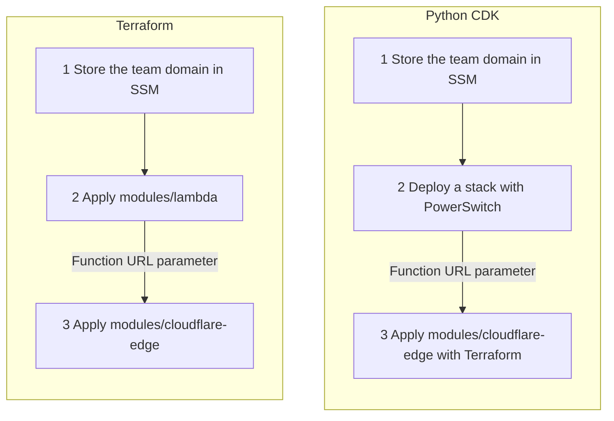

# Install inside your stack

How to add the power switch to a stack you already have. To deploy it as its own stack instead, use a ready-made example: [Terraform standalone](../README.md#terraform-standalone) or [CDK standalone](../README.md#cdk-standalone).

**Contents:** [Steps](#1-store-your-access-team-domain) · [Cloudflare API token permissions](#cloudflare-api-token-permissions) · [Inputs](#inputs) · [Outputs](#outputs) · [What gets created](#what-gets-created)

Each install is one Lambda in one AWS account and one region, plus one hostname in Cloudflare. It lists and switches only the instances in that account and region. For another region, install again there with a different `name_prefix` and hostname. Pick Terraform or CDK for the AWS side; the Cloudflare side is always the Terraform `cloudflare-edge` module.



The pieces talk through three SSM parameters in the Lambda's account and region. Their names are inputs, so you choose them:

| Parameter | Written by | Read by |
| --- | --- | --- |
| `access_team_domain_parameter` | **you**, once (step 1) | the Lambda, at cold start |
| `function_url_parameter` | the lambda module or the CDK construct | the edge module, at plan time, unless you pass it `function_url` instead |
| `access_aud_parameter` | the edge module | the Lambda, at cold start |

**Apply order:** the AWS side first (lambda module or CDK stack), then the edge module. Given `function_url_parameter`, the edge module reads the Function URL from the SSM parameter the AWS side writes, so it can't plan before that parameter exists. Given `function_url` instead, it reads no parameter. Until the edge has written the Access AUD parameter, the Lambda can't load its settings and every request fails; it tries again on the next request.

## 1. Store your Access team domain

Your Cloudflare Zero Trust team domain, without `https://`:

```sh
aws ssm put-parameter --name /example/access_team_domain --type String \
  --value example.cloudflareaccess.com
```

## 2a. AWS side with Terraform

```hcl
module "power_switch" {
  source = "git::https://github.com/freshmick/aws-power-switch.git//modules/lambda?ref=v0.1.1"

  name_prefix                  = "example"
  power_hostname               = "power.example.com"
  access_team_domain_parameter = "/example/access_team_domain"
  access_aud_parameter         = "/example/power/access_aud"
  function_url_parameter       = "/example/power/function_url"
}
```

If the edge module lives in the same root module, pass it `function_url = module.power_switch.function_url` instead of `function_url_parameter` and a single `terraform apply` does both, as [`examples/terraform-standalone`](../examples/terraform-standalone) does. With `function_url_parameter`, apply this one first with `terraform apply -target=module.power_switch`, then run `terraform apply`.

## 2b. AWS side with CDK (Python)

```sh
pip install "aws-power-switch-cdk @ git+https://github.com/freshmick/aws-power-switch.git@v0.1.1#subdirectory=cdk"
```

```python
from aws_power_switch_cdk import PowerSwitch

PowerSwitch(
    stack,
    "PowerSwitch",
    name_prefix="example",
    power_hostname="power.example.com",
    access_team_domain_parameter="/example/access_team_domain",
    access_aud_parameter="/example/power/access_aud",
    function_url_parameter="/example/power/function_url",
)
```

The construct takes the same inputs, with the same defaults, as the Terraform lambda module, as keyword arguments. It exposes `function` (the Lambda function) and `function_url`. Deploy the stack, then apply the edge module below with Terraform, passing it the same `function_url_parameter` and `access_aud_parameter` names.

To deploy it as its own stack instead, use `PowerSwitchStack(app, "PowerSwitch", ...)`: the same keyword arguments, plus any `Stack` option such as `env` or `description`. It exposes the construct as `power_switch` and outputs the Function URL. [`examples/cdk-standalone`](../examples/cdk-standalone) is a ready-made app around it, see [CDK standalone](../README.md#cdk-standalone).

## 3. Cloudflare side (Terraform, for both)

```hcl
module "power_switch_edge" {
  source = "git::https://github.com/freshmick/aws-power-switch.git//modules/cloudflare-edge?ref=v0.1.1"

  account_id             = "0123456789abcdef0123456789abcdef"
  name_prefix            = "example"
  zone_name              = "example.com"
  power_hostname         = "power.example.com"
  function_url_parameter = "/example/power/function_url"
  access_aud_parameter   = "/example/power/access_aud"
  allowed_idps           = ["00000000-0000-0000-0000-000000000000"]
  policy_ids             = ["11111111-1111-1111-1111-111111111111"]
}
```

The edge module needs both the `cloudflare` provider (`~> 5.0`) and the `aws` provider (`~> 6.0`); point the `aws` provider at the Lambda's account and region, since that's where the parameters live. It creates a Worker on `power_hostname` (with its DNS record) and an Access application that allows exactly your `allowed_idps` and `policy_ids`. It creates no Access policy of its own.

Then tag some instances ([tag contract](../README.md#the-tag-contract)) and open `https://power.example.com`.

## Cloudflare API token permissions

The `cloudflare` provider reads the token from `CLOUDFLARE_API_TOKEN`. Create a [custom token](https://developers.cloudflare.com/fundamentals/api/get-started/create-token/) with these permissions, for your account and the zone of `power_hostname`:

| Scope | Permission | Access | What needs it |
| --- | --- | --- | --- |
| Account | Workers Scripts | Edit | The Worker script and its custom domain on `power_hostname`. |
| Account | Access: Apps and Policies | Edit | The Access application; in the standalone examples, also the Access policy. |
| Account | Access: Organizations, Identity Providers, and Groups | Read | Standalone examples only: looking up your Access team domain. |
| Zone | Zone | Read | Looking up the zone ID of `zone_name`. |
| Zone | Workers Routes | Edit | The Worker's custom domain on `power_hostname`. |

## Inputs

**`modules/lambda` and the `PowerSwitch` construct** (same names and defaults)

| Input | Required | Default | What it is |
| --- | --- | --- | --- |
| `name_prefix` | yes | | Prefix for resource names; the function, role and log group are named `<name_prefix>-power-switch`. |
| `power_hostname` | yes | | Hostname the page is served on, e.g. `power.example.com`. POSTs from any other origin are refused. |
| `access_team_domain_parameter` | yes | | Name of the SSM parameter holding your Access team domain (you create it). Read only. |
| `access_aud_parameter` | yes | | Name of the SSM parameter holding the Access application's audience (the edge module writes it). Read only. |
| `function_url_parameter` | yes | | Name of the SSM parameter this module creates with the Function URL. |
| `tag_key` | no | `"power-switch"` | Only EC2 and RDS instances carrying this tag key are listed and switchable. |
| `reserved_concurrency` | no | `2` | Maximum concurrent invocations; caps what a flood on the public Function URL can use. `null` (Terraform) or `None` (CDK) reserves no concurrency: see the note below. |
| `log_retention_days` | no | `14` | How long the function's logs are kept, in days. |

> **Low concurrency limit?** Accounts with a low Lambda concurrency limit (new accounts often have 10) can reject the deploy with "decreases account's UnreservedConcurrentExecution below its minimum value". This is taken from the Lambda documentation and was not reproduced. The workaround is to set `reserved_concurrency` to `null` (Terraform) or `None` (CDK): the function then has no reserved concurrency, so a flood on the public URL is no longer capped.

**`modules/cloudflare-edge`** (all required, except that you set exactly one of `function_url` and `function_url_parameter`)

| Input | What it is |
| --- | --- |
| `account_id` | Cloudflare account ID that owns the Worker and the Access application. |
| `name_prefix` | Prefix for the Worker script and Access application names; lowercase letters, digits and hyphens. Unique per Cloudflare account. |
| `zone_name` | Cloudflare zone the hostname belongs to, e.g. `example.com`. |
| `power_hostname` | Hostname of the page, e.g. `power.example.com`; the same value as on the AWS side. |
| `function_url` | The Function URL itself, e.g. the lambda module's `function_url` output. The module then reads no SSM parameter. |
| `function_url_parameter` | Name of the SSM parameter holding the Function URL; the same name as on the AWS side. |
| `allowed_idps` | IDs of existing Access identity providers to sign in with. Must not be empty. |
| `policy_ids` | IDs of existing reusable Access policies, in precedence order. Must not be empty. |
| `access_aud_parameter` | Name of the SSM parameter to write the Access application's audience to; the same name as on the AWS side. |

## Outputs

| Where | Output | What it is |
| --- | --- | --- |
| `modules/lambda` | `function_url` | The Function URL the edge forwards to. Returns 401 without a valid Access token. |
| `modules/lambda` | `function_name` | Name of the Lambda function. |
| `PowerSwitch` | `function` | The Lambda function construct. |
| `PowerSwitch` | `function_url` | The Function URL. |
| `modules/cloudflare-edge` | `access_aud` | Audience tag of the power switch's Access application. |

## What gets created

**AWS** (lambda module or CDK construct, the same resources either way):

- Lambda function `<name_prefix>-power-switch`: Node 22, arm64, 128 MB, 15 s timeout, outside any VPC, with reserved concurrency.
- A public Function URL (auth type `NONE`; the app checks the Access token itself) and the permissions to invoke it.
- IAM role and inline policy, see [Security model](security.md).
- CloudWatch log group `/aws/lambda/<name_prefix>-power-switch`.
- SSM parameter `function_url_parameter`.

**Cloudflare and AWS** (edge module):

- Worker script `<name_prefix>-power-switch` and a custom domain on `power_hostname`, which also creates its DNS record.
- Access application `<name_prefix> power switch` on `power_hostname`, using your identity providers and policies.
- SSM parameter `access_aud_parameter`.
