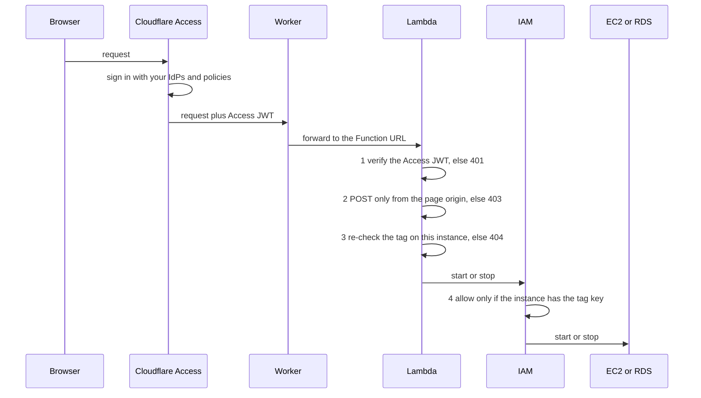

# Security model

The Function URL is public, so the app trusts nothing in front of it. Every check below lives in the app or in IAM, and they stack:

| Check | Where | What it stops |
| --- | --- | --- |
| **Access JWT on every route** | [`app/access.mjs`](../app/access.mjs), [`app/handler.mjs`](../app/handler.mjs) | Every route, the page included, needs a valid `Cf-Access-Jwt-Assertion`: RS256, signed by your team's Access keys, with your application's `aud`, your team's `iss`, unexpired, and carrying `sub` and `email`. Otherwise 401. Calling the raw Function URL gets you nothing. |
| **Per-action tag re-check** | [`app/resources.mjs`](../app/resources.mjs) | Before every start or stop, the app lists the tagged instances again and refuses (404) an ID that isn't among them. Only `ec2` and `rds` are valid types. |
| **Tag-conditioned IAM** | [`modules/lambda/iam.tf`](../modules/lambda/iam.tf), [`cdk/src/aws_power_switch_cdk/iam.py`](../cdk/src/aws_power_switch_cdk/iam.py) | The role can describe EC2 and RDS instances, but start and stop only instances carrying the tag key (`aws:ResourceTag/<tag_key>`, `rds:db-tag/<tag_key>`). It reads only the two Access parameters and writes only its own logs. |
| **Same-origin POSTs** | [`app/origin.mjs`](../app/origin.mjs) | A start or stop POST must say `Sec-Fetch-Site: same-origin` or carry `Origin: https://<power_hostname>`. A form on another site, even another subdomain of your zone, gets 403. |
| **Junk-token guard** | [`app/access.mjs`](../app/access.mjs) | Signing keys are cached; a token with an unknown key ID triggers at most one key fetch per minute, so random junk tokens can't make the function hammer Cloudflare. |
| **Reserved concurrency** | `reserved_concurrency` (default 2) | A flood on the public URL can't use up the account's shared Lambda concurrency. |

<b>Also in place</b>

- Every start and stop is logged as JSON audit lines (`requested`, then `accepted`, `refused` or `failed`) with the caller's `email` and `sub` from the verified token, never the token itself.
- AWS errors are logged, not returned; the browser sees `502 Upstream error`.
- Every response carries `Content-Security-Policy: frame-ancestors 'none'` and `X-Frame-Options: DENY`.
- The Worker copies only the path and query onto the Function URL, so a crafted path can't send the Access token to another host.
- The Access session cookie is `HttpOnly` and `SameSite=Lax`.

**Who can switch what:** anyone the install's Access policies let in can switch every tagged EC2 and RDS instance in that install's AWS account and region. There are no per-group permissions, and one install covers one account and one region.

Found a security problem? [SECURITY.md](../SECURITY.md) says how to report it privately.
